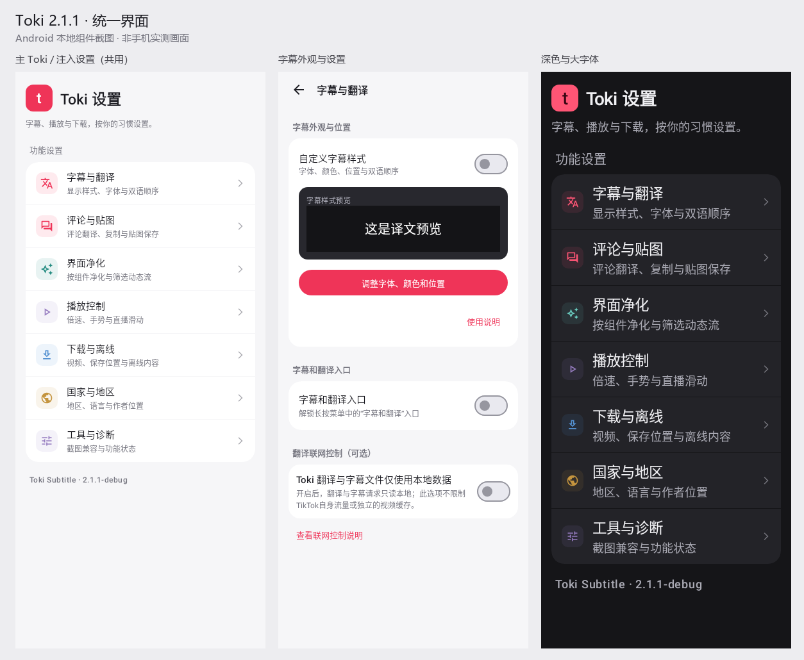

# 主应用／注入统一界面与日志占用 — 2.1.1 /121

## 当前：2.1.1-debug /121 — 主应用与注入界面统一、日志采集限额；已构建待设备验收（2026-11-06）

用户已认可统一界面预览，并要求同时整理独立Toki主应用。范围是TikTok内全部Toki注入界面与独立管理端，保留现有功能和开关语义。用户另提供截图，显示trial-logs内多个logcat-0.txt达到几百MB至约1.25GB；本轮加入日志占用修复。

- 主应用与注入设置共用七类入口：字幕与翻译、评论与贴图、界面净化、播放控制、下载与离线、国家与地区、工具与诊断。保留原58处配置写入表达式及全部原选项，分类切换不写设置；返回先退出分类。主应用首页先展示真实激活／宿主状态，再展示工具、偏好和关于信息；版本、原作者与支持入口保留。
- Compose界面共用固定的浅／深色、字号和圆角。注入主设置的语言、字幕、手动适配、诊断与同步状态保留，入口收进紧凑工具栏。系统控件弹窗仅由明确的Toki构造器设置主题与底部位置，不全局修改TikTok的原生窗口。
- 评论行使用本地姓名首字头像和紧凑更多菜单，顶部保留全局三种模式；回复和媒体已有逻辑保留。平台总数与本地评论／回复数量分开，减少把展开数量误当缓存总量。没有引入头像联网、额外下载或伪造缺失图片。
- 已找到日志源头：旧采集直接把root logcat输出重定向到文件，8MiB限制只在ZIP导出阶段生效。新采集由有界管道控制写入，每文件最多8MiB、最长10分钟；内部总占用达到64MiB拒绝新采集，不自动删除旧记录。错误或超时会结束本次受控采集并释放配额。
- 新导出直接把诊断快照写入用户选择的ZIP，不在内部反复保存snapshot目录；每条目8MiB／包内原始数据32MiB限制保留。停止采集发生在打开保存选择器前，取消保存不再导致本次采集继续运行。
- 日志页显示内部占用和文件数，提供刷新、停止与清理入口。清理先展示确切文件清单对应的数量、大小、范围及不可撤销说明，只有用户点确认后才删除；只处理本次已列出的trial-logs文件，拒绝符号链接与越界路径，不递归清除目录。用户此前的大日志未被代理删除，设置、离线视频、评论和字幕未清除。
- 32项定向测试、852项源码检查及589份生产输入一致性通过。包含真实Compose分类与返回检查、浏览不改配置、深色大字体、模块资源、框架弹窗与模式菜单、有界日志／超时／配额、导出不留副本。产生的本地Android截图不是手机实测；没有运行真实su命令或破坏性清理测试。
- 统一包和隔离兼容载荷的版本、签名、CRC、对齐、命名空间及新增类通过。APK：`Toki-2.1.1-debug.apk`，88292339字节，SHA-256 `071646202139e4ae44bee4c787ed89b5067709641b9a766df462236ea5f3ebdb`。
- 本轮没有安装、重启、改手机开关或清除实际日志。真实TikTok注入布局、现有设备采集进程退出与空间回收仍待设备验收。已有旧日志不会自动缩小，需在确认范围后由用户手动清理。

**离线评论只显示20条、缺少回复／图片贴图、后台持续下载的问题仍未解决**；本轮按用户要求优先统一界面并处理日志，未用外观更新宣称数据链路修复。HDR继续停止。证据保留在忽略目录`work/unified-ui-20261106/`；设计参考原件同样保留在本地，不上传第三方原始源码或截图。

